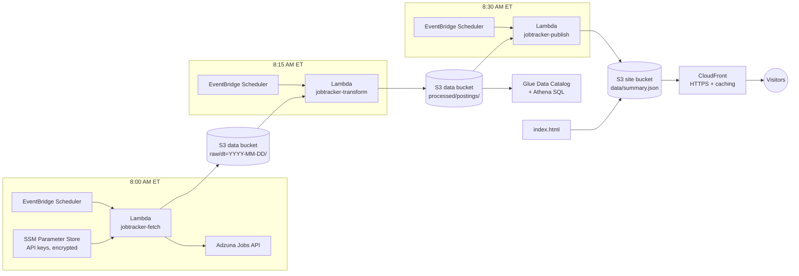

# AWS Job Market Tracker

A serverless data pipeline on AWS that collects tech job postings every day and tracks which skills employers ask for across cloud, data, and software engineering roles.

**Live dashboard:** [YOUR-CLOUDFRONT-URL](https://YOUR-CLOUDFRONT-URL)

> **Status:** Live. The pipeline runs automatically every morning and the dashboard updates itself. Next up is Infrastructure as Code and CI/CD (see [Roadmap](#roadmap)).

## Why I built this

Job postings show what employers want right now. I wanted to answer questions like:

- Which cloud platform appears most in cloud engineering postings: AWS, Azure, or GCP?
- How common is Infrastructure as Code (Terraform) compared with the cloud platforms themselves?
- How do skill requirements differ between cloud, data, and software engineering roles?
- How does demand change over time?

The project also gave me hands-on practice with the AWS services that show up most often in job postings.

## Architecture



### How it works

1. **Ingest (8:00 AM ET).** EventBridge Scheduler triggers the fetch Lambda. It reads the Adzuna API credentials from SSM Parameter Store as encrypted SecureStrings, queries the API for each tracked job title, and writes the raw JSON to S3, partitioned by date (`raw/dt=2026-10-16/cloud_engineer.json`).
2. **Transform (8:15 AM ET).** A second Lambda reads that day's raw files, flattens each nested API response into one row per posting, tags each posting with the skills it mentions, and writes the result as JSON Lines to `processed/postings/dt=YYYY-MM-DD/`.
3. **Query.** An Athena table defined in the Glue Data Catalog sits on top of the processed data for ad hoc SQL analysis. Partition projection maps each `dt=` folder to a partition automatically, and a view (`postings_unique`) removes postings that appear on several days.
4. **Publish (8:30 AM ET).** A third Lambda reads the full processed history, computes the dashboard's numbers (skill shares by role, cloud platform trends, median salaries), and writes them as one small `summary.json` file to a separate website bucket.
5. **Serve.** The dashboard is a single static `index.html` that loads `summary.json` in the browser. CloudFront serves both over HTTPS from a private S3 bucket, so there is no server or database query on page load.
6. **Security.** IAM follows least privilege at every stage. Each Lambda can read only the stage before it and write only its own output prefix. Each EventBridge schedule has its own role that can invoke only its target function. The website bucket blocks all public access, and CloudFront reads it through Origin Access Control.

## AWS services used

| Service | Purpose |
|---|---|
| Amazon S3 | Data lake (raw and processed zones) and a separate private bucket for the website |
| AWS Lambda | Serverless ingestion, transformation, and publishing (Python) |
| Amazon EventBridge Scheduler | Daily cron triggers for each pipeline stage |
| AWS Systems Manager Parameter Store | Encrypted storage for API credentials |
| AWS Glue Data Catalog | Table and view definitions for the processed data |
| Amazon Athena | Serverless SQL analysis directly on S3 |
| Amazon CloudFront | HTTPS delivery and caching for the dashboard, with Origin Access Control |
| AWS IAM | Least-privilege roles and policies for each component |
| Amazon CloudWatch Logs | Function logging, run history, and debugging |

## Findings so far

From 963 unique postings collected between October 8 and 16, 2026:

- **Azure appeared more often than AWS in cloud engineer postings** (32.2% vs. 25.4%, with GCP at 6.5%). The gap held as the sample grew from one day to a week.
- **Early samples were misleading.** A single day's 100 postings showed Terraform in 21% of cloud engineer postings. Across the full dataset it is 10.5%. This is why the pipeline collects data daily instead of relying on a one-off snapshot.
- **Data engineer postings center on SQL (17.9%), Python (14.0%), and Snowflake (10.7%).**
- **About 26% of daily rows are repeats.** The same posting is often returned on several days, so 1,300 collected rows reduce to 963 unique postings. All findings use deduplicated data.

The [live dashboard](https://YOUR-CLOUDFRONT-URL) shows the current numbers, which update every morning.

## Repository structure

```
├── lambda/
│   ├── fetch/lambda_function.py         # Ingest: Adzuna API -> S3 raw zone
│   ├── transform/lambda_function.py     # Transform: raw JSON -> flat rows with skill tags
│   └── publish/lambda_function.py       # Publish: processed history -> dashboard summary.json
├── dashboard/
│   └── index.html                       # Static dashboard (no dependencies, no build step)
├── athena/
│   ├── setup.sql                        # Database, table (partition projection), dedup view
│   └── queries.sql                      # Analysis queries
├── iam/
│   ├── jobtracker-fetch-policy.json     # Least-privilege policy for each Lambda
│   ├── jobtracker-transform-policy.json
│   └── jobtracker-publish-policy.json
├── fetch_jobs.py                        # Local prototype of the ingestion script
├── analyze_skills.py                    # Local prototype of the skill analysis
└── README.md
```

## Example query

Share of unique postings that mention each skill, by role:

```sql
WITH totals AS (
  SELECT search_term, COUNT(*) AS total
  FROM jobtracker.postings_unique
  GROUP BY search_term
)
SELECT p.search_term, s.skill,
       ROUND(100.0 * COUNT(*) / t.total, 1) AS pct
FROM jobtracker.postings_unique p
CROSS JOIN UNNEST(p.skills) AS s(skill)
JOIN totals t ON p.search_term = t.search_term
GROUP BY p.search_term, s.skill, t.total
ORDER BY p.search_term, pct DESC;
```

More queries are in [`athena/queries.sql`](athena/queries.sql).

## Running locally

The local scripts are the prototype the Lambda functions grew out of.

```bash
python3 -m venv .venv
source .venv/bin/activate
pip install requests python-dotenv

# Add your Adzuna credentials to a .env file (never committed):
#   ADZUNA_APP_ID=...
#   ADZUNA_APP_KEY=...

python fetch_jobs.py       # saves postings to data/raw/
python analyze_skills.py   # prints a skills report, writes data/processed/skills_summary.csv
```

## Design decisions

- **Serverless over EC2.** Each stage runs for a few seconds once a day. Lambda costs effectively nothing at this scale and needs no server maintenance.
- **Separate raw and processed zones.** Raw API responses are stored unmodified, so the transformation logic can change later and be re-run over the full history.
- **Idempotent, fault-tolerant ingestion.** The Adzuna API occasionally returns HTTP 503 errors. The fetch function retries with exponential backoff, keeps going if one job title fails, and skips titles already saved for the day. Lambda's automatic retries therefore fetch only what is missing, instead of repeating successful work and wasting API calls.
- **Partition projection over Glue crawlers.** The date partitions follow a predictable pattern, so Athena computes them from the table definition. New days are queryable immediately, with no crawler to schedule or pay for.
- **Precomputed dashboard data.** The publish Lambda computes every number once a day and writes a 3 KB JSON file. The dashboard is fully static, so it loads instantly, costs nothing per visit, and can't be used to run expensive queries.
- **Separate, private website bucket.** The site lives in its own bucket, so the data lake never needs public access. CloudFront reads the site bucket through Origin Access Control, and the bucket itself blocks all public access.
- **Different cache lifetimes for page and data.** `summary.json` is cached for one hour, so the morning update appears quickly. `index.html` is cached for five minutes. CloudFront invalidations are used when a change must appear immediately.
- **No WAF on the dashboard.** AWS WAF has a fixed monthly cost, and a read-only static site with no forms or logins gains little from it. CloudFront includes AWS Shield Standard for basic DDoS protection at no extra cost.
- **JSON Lines for processed data.** It is simple to write with the Python standard library and Athena reads it natively. At this data volume, converting to Parquet would add packaging complexity for little benefit. Parquet is the planned format if the dataset grows.
- **Parameter Store over Secrets Manager.** Standard SecureString parameters are free and meet the need here. Secrets Manager adds automatic rotation, which this API key doesn't require.
- **Standard library only.** All three Lambda functions use only the Python standard library and the built-in `boto3`, and the dashboard uses no JavaScript libraries, so nothing needs packaging or a build step.

## Known limitations

- **Truncated descriptions.** The Adzuna API returns only a snippet of each job description, so skill percentages undercount real demand. Comparisons between roles and trends over time are more meaningful than the absolute numbers.
- **Sample per day.** Each run collects the 100 most recent postings per role, not every posting available.
- **Sparse salary data.** Most postings don't state a salary. Adzuna's estimated salaries (`salary_is_predicted = 1`) are excluded from salary analysis.
- **Keyword matching.** Skills are detected by keyword matching, which can miss synonyms or catch unrelated uses of a word.
- **Gaps from API outages.** October 15 is missing data and software engineer postings because of Adzuna errors that occurred before retry logic was added.
- **Manual deployment.** Resources were created in the AWS console. Terraform and CI/CD are next on the roadmap.

## Roadmap

- [x] Local prototype: data fetching and skill analysis
- [x] Automated daily ingestion on AWS (Lambda, S3, EventBridge, Parameter Store)
- [x] Retry logic and idempotent re-runs for API failures
- [x] Transformation Lambda: raw JSON to flat, skill-tagged rows
- [x] Glue Data Catalog and Athena for SQL analysis, with a deduplicated view
- [x] Public dashboard: publish Lambda, private S3 site bucket, CloudFront
- [ ] Infrastructure as Code with Terraform
- [ ] CI/CD with GitHub Actions
- [ ] CloudWatch alarm and SNS email alert on failed runs

## Data source

<a href="https://www.adzuna.com">Jobs by Adzuna</a>. Job data is provided by the Adzuna API.