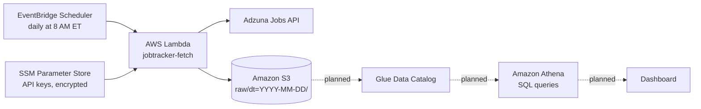

# AWS Job Market Tracker

A serverless data pipeline on AWS that collects tech job postings every day and tracks which skills employers ask for across cloud, data, and software engineering roles.

> **Status:** In progress. Daily ingestion is live on AWS. Transformation, SQL querying, and the dashboard are next (see [Roadmap](#roadmap)).

## Why I built this

Job postings show what employers want right now. I wanted to answer questions like:

- Which cloud platform appears most in cloud engineering postings: AWS, Azure, or GCP?
- How common is Infrastructure as Code (Terraform) compared with the cloud platforms themselves?
- How do skill requirements differ between cloud, data, and software engineering roles?
- How does demand change over time?

The project also gave me hands-on practice with the AWS services that show up most often in job postings.

## Architecture



### How it works

1. **EventBridge Scheduler** triggers the Lambda function every morning.
2. **Lambda** (Python) reads the Adzuna API credentials from **SSM Parameter Store** as encrypted SecureStrings, so no secrets are stored in code.
3. The function queries the Adzuna API for each tracked job title and writes the raw JSON to **S3**, partitioned by date (`raw/dt=2026-10-14/cloud_engineer.json`). This Hive-style layout lets Athena treat each day as a partition and scan only the dates a query needs.
4. **IAM** follows least privilege: the Lambda role can only write to the `raw/` prefix of one bucket and read parameters under `/jobtracker/`. EventBridge has its own role, which can only invoke this one function.

## AWS services used

| Service | Purpose |
|---|---|
| Amazon S3 | Data lake storage for raw and processed data |
| AWS Lambda | Serverless data ingestion (Python) |
| Amazon EventBridge Scheduler | Daily cron trigger |
| AWS Systems Manager Parameter Store | Encrypted storage for API credentials |
| AWS IAM | Least-privilege roles and policies |
| Amazon CloudWatch Logs | Function logging and run history |

## Early findings

From a first sample of 300 postings (100 per role, October 2026):

- **Azure appeared more often than AWS in cloud engineer postings** (28% vs. 20%).
- **Terraform (21%) appeared about as often as AWS** in cloud engineer postings, which shows how standard Infrastructure as Code has become.
- Cloud engineer postings named specific tools far more often than data or software engineer postings. This is partly a data limitation (see below).

These numbers come from a single day. The daily pipeline is collecting more data to support trend analysis.

## Repository structure

```
├── lambda/
│   └── fetch/
│       └── lambda_function.py         # Production ingestion function (Lambda)
├── iam/
│   └── jobtracker-fetch-policy.json   # Least-privilege policy for the Lambda role
├── fetch_jobs.py                      # Local version of the ingestion script
├── analyze_skills.py                  # Skill extraction and salary analysis
└── README.md
```

## Running locally

```bash
python3 -m venv .venv
source .venv/bin/activate
pip install requests python-dotenv

# Add your Adzuna credentials to a .env file (never committed):
#   ADZUNA_APP_ID=...
#   ADZUNA_APP_KEY=...

python fetch_jobs.py       # saves postings to data/raw/
python analyze_skills.py   # prints a skills report, writes data/processed/skills_summary.csv
```

## Design decisions

- **Serverless over EC2:** The job runs for a few seconds once a day. Lambda costs effectively nothing at this scale and needs no server maintenance.
- **Parameter Store over Secrets Manager:** Standard SecureString parameters are free and meet the need here. Secrets Manager adds automatic rotation, which this API key doesn't require.
- **Standard library only in Lambda:** The function uses `urllib` and the built-in `boto3`, so it deploys without packaging dependencies.
- **Raw data kept unmodified:** Raw API responses are stored as-is, so the transformation logic can change later and be re-run over the full history.

## Known limitations

- **Truncated descriptions:** The Adzuna API returns only a snippet of each job description, so skill percentages undercount real demand. Comparisons between roles and trends over time are more meaningful than the absolute numbers.
- **Sparse salary data:** Most postings don't state a salary. Adzuna's estimated salaries (`salary_is_predicted = 1`) are excluded from salary analysis.
- **Keyword matching:** Skills are detected by keyword matching, which can miss synonyms or catch unrelated uses of a word.

## Roadmap

- [x] Local prototype: data fetching and skill analysis
- [x] Automated daily ingestion on AWS (Lambda, S3, EventBridge, Parameter Store)
- [ ] Transform raw JSON into Parquet in a `processed/` zone
- [ ] Glue Data Catalog and Athena for SQL queries
- [ ] Public dashboard (static site on S3 + CloudFront)
- [ ] Infrastructure as Code with Terraform
- [ ] CI/CD with GitHub Actions
- [ ] CloudWatch alarm and SNS email alert on failed runs

## Data source

<a href="https://www.adzuna.com">Jobs by Adzuna</a>. Job data is provided by the Adzuna API.